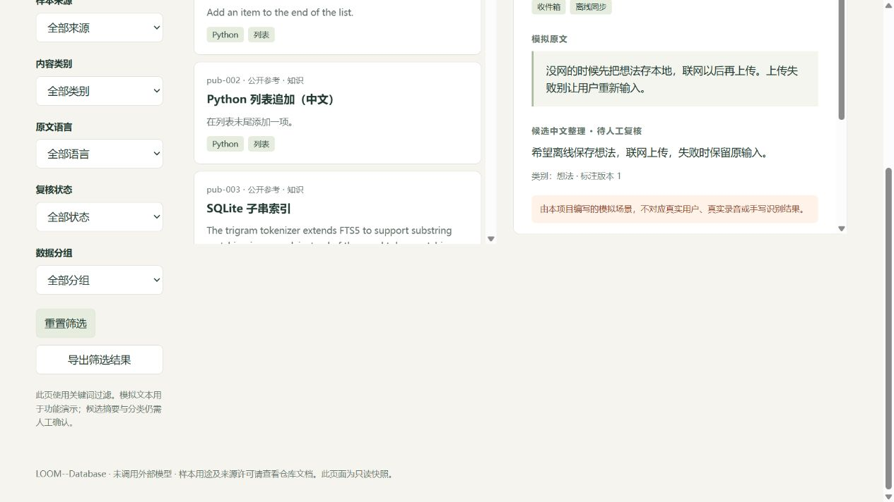

# LOOM Database · 样本与标注工作台

为 LOOM「想法收件箱 + AI 加工」准备的独立数据库交付：**可追溯样本、保留历史的标注、全文子串检索、MySQL 对接资料**。

首版日期：2026-10-22。仓库：[Yeggy496/LOOM--Database](https://github.com/Yeggy496/LOOM--Database)。

## 先打开什么

| 入口 | 用途 |
| --- | --- |
| [exports/viewer.html](exports/viewer.html) | 下载仓库后双击打开；关键词搜索、六种筛选、原文与整理对照、导出筛选结果 |
| [exports/loom.db](exports/loom.db) | 可直接检查的 SQLite 数据库快照 |
| [exports/notes.json](exports/notes.json) | 页面展示、后端导入和 AI 实验的数据契约 |
| [exports/notes.csv](exports/notes.csv) | Excel 可打开的 UTF-8 BOM 表格 |
| [docs/数据库设计.md](docs/数据库设计.md) | 实体关系、约束、索引与技术选择 |
| [docs/后端对接.md](docs/后端对接.md) | Spring Boot / MySQL 对接边界及队友数据字段映射 |
| [docs/验收报告.md](docs/验收报告.md) | 实际执行结果、检索局限与未完成项 |

GitHub 文件预览不会执行 HTML；先下载文件或整个仓库，再在浏览器打开。



## 这一版有什么

- **32 条独立整理样本**：20 条技术文档短摘录 + 12 条模拟速记；中文 19 条、英文 13 条。公开来源与模拟文本在库中强制区分。
- **9 张普通表**（含 SQLite 迁移记录），外加派生全文索引；原文、来源、标注版本和核查证据各自保存。
- **增量迁移**：SQLite 迁移编号和 SHA-256 校验，拒绝偷偷修改已应用的历史脚本。
- **标注版本**：修改会追加修订，保留旧摘要、类别和标签；通过 `expected_revision` 防止两位成员互相覆盖。
- **检索**：SQLite FTS5 trigram + BM25 排序；不足 3 字符时用转义后的字面匹配。支持中英文子串，不具备语义理解。
- **交付工具**：事务导入、重导保护、原文哈希、分组检查、CSV 公式防护、同一快照的多格式导出和文件校验清单。
- **MySQL**：独立空开发库的版本化基线与 8 表种子导出；GitHub Actions 配置 MySQL 8.0 / 8.4 逐字段对照测试。

所有候选标注均由 AI 辅助整理，**首版人工复核数为 0**。公开摘录来自技术参考文档，并非真实学生笔记；模拟转写/OCR 字样只表示人为编写的测试文本，没有运行录音转写或手写识别。未调用 GLM、Redis 或应用服务。禁止把模拟数据包装成用户数据。

## 快速使用

需要 Python 3.12+，以及支持 FTS5 trigram 的 SQLite（程序会在迁移时检测能力）。核心工具只用 Python 标准库。以下命令在仓库根目录执行；Windows 可把 `python` 换成 `py`。

```powershell
python -m loomdb migrate
python -m loomdb import data/public_references.json
python -m loomdb import data/synthetic_inbox.json
python -m loomdb check
python -m loomdb search "离线"
python -m loomdb search "substring" --split test
python -m loomdb show syn-001
python -m loomdb export
python -m loomdb evaluate --output exports/retrieval_eval.json
python -m unittest discover -s tests -v
python scripts/verify_delivery.py
```

默认工作库为 `runtime/loom.db`，不进入 Git；发布快照在 `exports/loom.db`。自选路径时，把 `--db` 放在子命令之前：

```powershell
python -m loomdb --db runtime/my-work.db migrate
```

重复导入原批次不会产生重复样本，也不会覆盖已复核标注。同 ID 的原文或来源发生变化时导入失败，整批回滚；需要修正原始快照时请使用新 ID 并说明关系。

## 两人如何复核

```powershell
python -m loomdb show syn-001
python -m loomdb review syn-001 --expected 1 --actor "你的姓名" --reason "逐句核对原文" --human --status verified
python -m loomdb export
```

`--expected` 必须与当前标注版本一致。需要修改摘要可加 `--summary "修订内容"`，修改标签可重复使用 `--tag`。AI 辅助修订不能覆盖已有人工决定；确认或拒绝必须显式声明 `--human`。这个离线工具记录操作者自述，**没有身份认证**，后端必须验证登录身份与权限。

修改工作库后，应重跑评测并更新交付报告；`verify_delivery.py` 会检查发布快照是否仍与仓库种子、复核批次和基线一致。正式交付的复核应按 [data/reviews/README.md](data/reviews/README.md) 保存为可重放的 JSON 批次，不能只替换二进制库。

## 与队友仓库的关系

参考了 [skh020309-maker/loom-database](https://github.com/skh020309-maker/loom-database) 的“公开样本 + SQLite/MySQL + 数据检查”交付范围。本仓库的代码、32 条数据和浏览界面独立编写，没有复制其源码或笔记样本；也不把它的已有结果记成本仓库成果。

可以按分工合并成果：队友继续公开个人笔记的采集和来源核查；本仓库侧重版本化标注、检索索引、模拟场景及可重复交付。需要交换数据时先做字段映射和来源核查，不直接把两套表拼接。详见[协作与对接](docs/后端对接.md)。

## 范围与数据责任

这是一套研究/演示样本库，正式 App 的账户、用户笔记、附件、AI 任务队列及端云同步由应用后端建设。MySQL 是与团队现有路线衔接的参考，不要求改用 Next.js 或另一套后端。

来源网页的读取检查与摘要的人工复核分开记录。首版公开来源的许可状态保守记为 `unknown`，这表示本次没有独立核对许可条款，并非声称这些站点没有许可。所有样本 `training_allowed=0`；仓库未授予第三方摘录的训练或商业使用许可。详见 [DATA_POLICY.md](DATA_POLICY.md)。

不要向公开仓库提交私密笔记、真实账户、录音、凭证或生产数据库。新增公开样本保留 URL、作者/维护团队、定位、采集日期和核查说明；模拟内容必须保持 `synthetic`。
