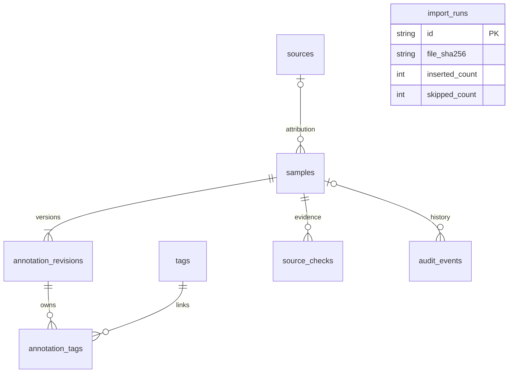

# 数据库设计

## 定位

本库管理可重放的研究样本和标注，不保存生产用户账户。SQLite 便于成员下载检查；MySQL 基线便于团队的 Spring Boot 后端试导入。正式 App 的本地 SQLite 需要另外的用户域、可编辑笔记和同步协议，不能把本样本库当成已完成的端云同步。

SQLite 共有 9 张普通表（下图 8 张 + `schema_migrations`），另外包含 `current_annotations` 视图、`sample_search` 全文虚表及 FTS 内部辅助表。辅助表不计入业务实体数量。

| 表 | 责任与关键约束 |
| --- | --- |
| `sources` | URL、维护作者/团队、许可快照；URL 唯一，归属不静默改写 |
| `samples` | 不可变原文、UTF-8 SHA-256、语言、来源类别、定位、日期、分组；公开摘录有来源且至多 500 字符；模拟输入无公开来源且至多 20000 字符 |
| `annotation_revisions` | 摘要、类别、标签快照、版本号、创建者、复核者和理由；每次修改追加新行 |
| `tags` / `annotation_tags` | 规范化多对多标签，关联到具体标注版本，不把旧标签变成新版本的标签 |
| `source_checks` | 逐样本核查证据；只追加，与摘要复核分开 |
| `import_runs` | 输入文件内容哈希及新增/跳过数量；记录真实导入动作 |
| `audit_events` | 导入及修订审计；复核请求内容哈希支持重放跳过 |
| `schema_migrations` | SQLite 已应用版本及脚本哈希；引擎专属，不导入 MySQL |

## 并发与历史

导入、单条修订、复核批次都在 `BEGIN IMMEDIATE` 事务中进行。非法批次整批回滚。相同 ID 重导比较不可变字段；相同原文换 ID 也不会绕过去重。种子标注不覆盖已有人工版本，标注修改必须通过修订入口。

修订要求 `expected_revision`。成员 A 读取版本 1 后，成员 B 已提交版本 2，则 A 的请求必须重新读取，不能覆盖版本 2。完全相同且已经成功应用的请求可重放跳过，即使随后已有版本 3。复核批次可保存到 `data/reviews/`，交付重建时按文件名顺序应用。

数据库触发器禁止直接更新或删除原文、来源归属、标注版本、核查和审计记录。已声明的版本标签不能添加未声明的新标签。数据库管理员仍可移除触发器；这些约束是防止常规误操作，不是防篡改认证系统。

## 迁移与发布

SQLite 脚本位于 `migrations/sqlite/001_core.sql`、`002_search.sql`。每个版本的 DDL 和迁移记录同一事务提交。已发布脚本不可修改；新结构变化增加下一个连续编号文件。迁移前备份工作库。

MySQL 文件采用 Flyway 风格的 `V001__corpus.sql` 命名，当前由 MySQL 客户端或 CI 对独立空库执行一次。Flyway 本身未打包进本仓库；接入后端项目时使用其迁移管理器维护版本，不能每次启动都执行本基线。

导出先使用 SQLite backup 获取一致快照，再由同一个冻结库生成 JSON、CSV、SQL、浏览页和发布数据库。`manifest.json` 记录文件 SHA-256；发布文件先完成再更新 manifest。`verify_delivery.py` 核对种子、复核批次、发布 JSON/SQLite、浏览页和检索基线。

## 检索实现

长度至少 3 字符的输入按单个字面短语传给 FTS5 trigram，使用 BM25 排序，标题权重高于原文；同分按样本 ID 稳定排序。短输入用转义的 LIKE；所有查询参数化，输入中的 SQL/FTS 操作符都当作文字。

标题、原文、当前摘要及当前标签进入索引。新增标注版本和标签关联时，触发器同步索引；旧摘要不出现在当前搜索中。浏览页使用内嵌快照上的大小写不敏感关键词过滤，功能与 CLI 排名不能混为一谈。

这能改善子串查找和排序，但不处理同义词、意图或模糊回忆。技术依据：[SQLite FTS5 trigram](https://www.sqlite.org/fts5.html#the_trigram_tokenizer)。当前数据量为 100 条，仍没有足够依据宣称大规模性能提升。
